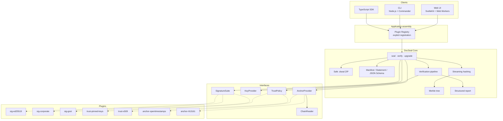

# DocSeal Architecture

## Goals

The architecture separates:

1. a portable, deterministically verifiable core;
2. client applications;
3. concrete signing methods and key storage;
4. trust rules;
5. timestamping methods.

This makes it possible to add enterprise, government, or hardware-backed signatures without changing the package logic or the Merkle tree.

## Components



Only `sig-ed25519`, `trust-pinned-keys`, and `anchor-opentimestamps` are planned for v0.1. The others illustrate extension points. The pinned-keys policy has no dependencies and ships inside `@docseal/core` as `pinnedKeys()`; it is still passed in explicitly like any other policy.

Applications assemble the registry with `new DocSeal({ signatures, anchors, trust, limits })`. `seal()` refuses keys whose suite is not registered and verifies its own signature before returning, so a faulty `KeyProvider` fails at the signer rather than at the recipient.

## Core boundary

The core is responsible for:

- format types and versioning;
- path normalization;
- hashing and the Merkle tree;
- canonicalization of signed data;
- safe container handling;
- plugin coordination;
- building the report.

The core must not:

- store user documents on a server;
- hold private keys;
- decide whom to trust without an explicit `TrustPolicy`;
- load plugin code by name from an untrusted package;
- implement Ed25519, SHA-256, GOST, or the OpenTimestamps protocol's cryptography itself.

The core uses only platform-neutral APIs (`Uint8Array`, async iterables, WebCrypto) and does not depend on `fs` or `Buffer`, so the same code runs in the browser in v0.2.

Packages and documents are never required to fit in memory. The core reads through `ByteSource` (random access: a Node file in the CLI, a `Blob` in the browser, or bytes in memory) and writes through `ByteSink` (sequential). Verification streams each document through SHA-256 in chunks; sealing reads each file twice, to hash it and then to write it; `upgrade` copies every entry except the anchor file without decompressing it. An application may pass a native SHA-256 for documents (the CLI uses Node's `crypto`); it is checked against a test vector when `DocSeal` is created.

## Plugin interfaces

See [docs/PLUGINS.md](docs/PLUGINS.md) for the full interfaces, the registry rules, and how to write a plugin.

### SignatureSuite

Verifies a specific cryptographic format. The first implementation is Ed25519. X.509/CMS, WebAuthn, or GOST are possible later.

### KeyProvider

Performs signing without exposing to the core how the key is stored. Possible implementations:

- a local encrypted file;
- a WebCrypto `CryptoKey`;
- a hardware HSM via PKCS#11;
- a cloud KMS;
- an enterprise remote-signing API;
- a local CryptoPro or Rutoken agent.

### TrustPolicy

Separately from mathematical correctness, decides whether the signing key is acceptable:

- pinned public keys;
- an enterprise trust list;
- an X.509 chain and trusted roots;
- role and department policies;
- key status at the confirmed point in time.

### AnchorProvider

Submits a digest, upgrades a pending proof, and verifies a confirmed timestamp proof. The first implementation is OpenTimestamps. See [docs/OPENTIMESTAMPS.md](docs/OPENTIMESTAMPS.md).

### ChainReader

Isolates access to public-network data. The source of trust must be visible in the report: an own node, an external explorer, or several sources.

## Clients

### CLI

The primary client for `v0.1`. Provides a reproducible, easily testable end-to-end flow before UI work starts.

### Web UI

The `v0.2` client (`apps/web`): a static SvelteKit site under a strict Content Security Policy. It uses the same core packages, built from their sources. Verifying and upgrading run in a verification worker that reads the package in chunks; a signer worker opens or creates the key, seals once, and is terminated, so the secret key never reaches the page. Workers reach the network only through `browserFetch`, which allows the calendars and chain sources of `network.js` and nothing else. Sealed packages are written straight to a picked file where the File System Access API exists, and otherwise built in memory up to a measured limit.

### Backend

Absent in `v0.1` and `v0.2`. In the future a server may perform only auxiliary operations: background `upgrade`, batching, webhooks, and an index of public digests. Documents are never sent to the server.

## Sealing a package

```text
files
  → stream hash
  → manifest
  → Merkle root
  → signed PackageStatement
  → signature envelope
  → seal
  → OpenTimestamps receipt
  → .dseal container
```

## Verifying a package

```text
.dseal
  → safe extraction
  → schema and limits
  → file hashes and Merkle root
  → statement/manifest binding
  → signature verification
  → trust evaluation
  → timestamp verification
  → component verdicts and overall result
```

## Enterprise extension

An enterprise signature is added through an adapter that passes the signable digest to an HSM or an internal API and returns the signature and the key/certificate identifier. The core and the package format stay unchanged, provided the envelope format already supports the algorithm and profile.

A government-grade signature may require a native cryptographic provider. In the browser this usually means a local agent rather than direct access from JavaScript.
