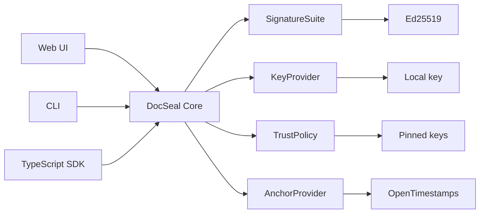

# DocSeal

> Open-source toolkit for creating portable, independently verifiable proofs of document integrity, authorship by a cryptographic key, and existence no later than a confirmed timestamp.

DocSeal is a library, CLI, and web verifier for creating verifiable document packages. Documents are processed locally. Only a cryptographic digest of the signed package state is sent to a public network.

The project is intended as a complete, portfolio-grade open-source project: first a small, well-tested core and CLI, then a browser interface. A server, legally binding signatures, and enterprise integrations are out of scope for the first releases.

## What DocSeal proves

- the integrity of every document and of the package composition;
- that the package was signed by the holder of a specific key;
- that the signed state existed no later than a time confirmed by OpenTimestamps.

## What DocSeal does not prove

- the identity of a natural or legal person, without an external PKI or another trust policy;
- that the contents of the documents are true;
- the exact original creation time of a document;
- legal validity or qualified status of a signature.

## Main workflows

### Sealing a package

1. The user selects files or a folder.
2. DocSeal computes a streaming SHA-256 of each file.
3. A `manifest.json` describing the composition and metadata is built.
4. A Merkle tree is built from the file entries.
5. A signable `statement.json` that explicitly contains the tree root is built.
6. The statement is signed through the Ed25519 plugin.
7. The digest of the signed state is submitted to OpenTimestamps.
8. Documents and proofs are packed into a `.dseal` file.

### Verifying a package

1. The container is extracted safely, with limits on sizes and paths.
2. Document hashes and the Merkle tree are recomputed.
3. The binding between `manifest.json` and `statement.json` is checked.
4. The signature and the trust policy are checked.
5. The OpenTimestamps proof is checked.
6. A detailed report is returned, with separate results for format, integrity, signature, trust, time, and completeness.

## Command line

```bash
docseal keygen -o me.key                       # encrypted Ed25519 key (development use)
docseal pubkey me.key                          # did:key to put in recipients' trusted-keys.json
docseal seal contract/ -k me.key -o contract.dseal
docseal verify contract.dseal --trust trusted-keys.json
docseal upgrade contract.dseal                 # a few hours later: complete the Bitcoin proof
```

`verify` exits with `0` when every check passed, `1` when the package was modified or a proof is false, `2` when nothing is wrong but not everything could be confirmed (pending time proof, unknown signer), and `3` on usage or I/O errors. `--json` prints the machine-readable report. The passphrase is asked on the terminal or read from `DOCSEAL_PASSPHRASE`.

By default `verify` reads Bitcoin block headers from the mempool.space Esplora API; use `--chain <url>` for your own Esplora instance or `--offline` to skip the time check.

## Package format

The first version uses a "fat" ZIP container that includes the documents themselves:

```text
example.dseal
├── mimetype
├── manifest.json
├── statement.json
├── files/
│   ├── document.pdf
│   └── attachment.docx
├── signatures/
│   └── 0001.json
└── anchors/
    └── seal-1.json
```

A "thin" package without `files/` is considered for a future release. See the [format specification](docs/FORMAT-v0.1.md).

## Architecture

All clients share one TypeScript core. Concrete mechanisms for signing, key storage, trust, and timestamping are provided by explicitly registered plugins.



A package can never bring its own executable plugin. The application registers trusted implementations up front.

## Stack

| Component | Choice |
|---|---|
| Language | TypeScript (strict) |
| Monorepo | pnpm workspaces |
| Build | tsup |
| Tests | Vitest, fast-check |
| Cryptography | WebCrypto, `@noble/hashes`, `@noble/curves`, `@noble/ciphers` |
| Canonicalization | RFC 8785 JCS |
| Container | ZIP via `fflate` |
| CLI | Node.js ≥ 22, Commander |
| Web | SvelteKit, Web Workers |
| Timestamp anchor | OpenTimestamps |
| CI and releases | GitHub Actions, GitHub Releases |

DocSeal does not implement cryptographic primitives itself. The core defines the signed data, the format, the verification rules, and adapters to vetted libraries or external providers.

## Status

The project is in the `v0.1` design stage. Implementation starts with a vertical prototype:

```text
one file → manifest → statement → Ed25519 → .dseal → verify
```

Changing a single byte must produce a negative verification result. After that come multiple files, the Merkle tree, OpenTimestamps, the CLI, and the web interface.

See the [roadmap](ROADMAP.md), [architecture](ARCHITECTURE.md), [format specification](docs/FORMAT-v0.1.md), [decisions](docs/DECISIONS.md), [threat model](THREAT_MODEL.md), and [security policy](SECURITY.md).

In-depth guides: [plugin system](docs/PLUGINS.md), [OpenTimestamps integration](docs/OPENTIMESTAMPS.md), and [testing](docs/TESTING.md).

## Development

Requires Node.js ≥ 22 and pnpm via Corepack (`corepack enable`).

```bash
pnpm install
pnpm check    # lint, typecheck, test
pnpm build
node apps/cli/dist/index.js --help
```

| Path | Contents |
|---|---|
| `spec/` | JSON Schemas and test vectors |
| `packages/core` | Format, hashing, Merkle tree, container, verification pipeline, plugin interfaces |
| `packages/sig-ed25519` | Ed25519 signature suite and development key provider |
| `packages/anchor-ots` | OpenTimestamps anchor provider |
| `apps/cli` | `docseal` command-line interface |

## Security and legal notice

DocSeal provides technical proofs of document integrity, digital signatures, and existence no later than a confirmed timestamp.

DocSeal does not verify that a signing key belongs to a particular person or organization, verify that a document's contents are true or legally valid, or provide legal advice, identity verification, certification, or qualified electronic signature services.

Blockchain and timestamp proofs establish an upper bound on when committed data existed. They do not prove when the data was originally created. Users are responsible for protecting private keys, selecting appropriate trust policies, and determining whether generated proofs satisfy applicable legal or regulatory requirements.

The software is provided under the Apache License 2.0 on an **AS IS** basis, without warranties or conditions of any kind. For legally significant use, consult qualified legal and information-security professionals.

## License

Apache License 2.0. See [LICENSE](LICENSE) and [NOTICE](NOTICE).
