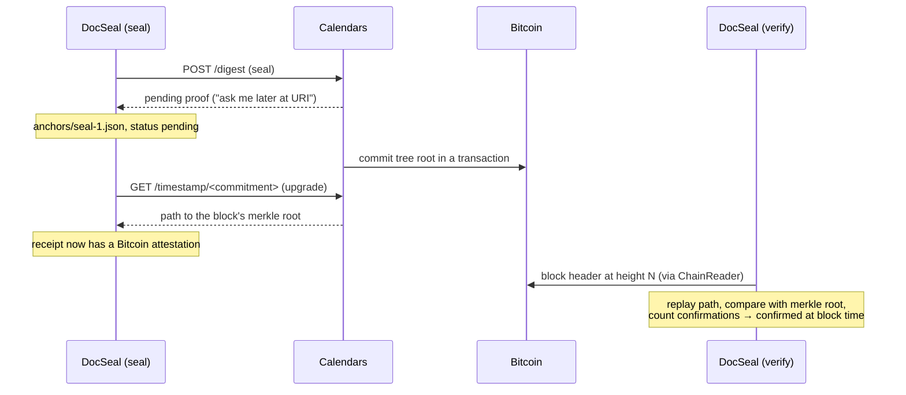

# OpenTimestamps in DocSeal

This document explains how DocSeal proves *when* a package existed, how the OpenTimestamps (OTS) integration in `@docseal/anchor-ots` works, and why it was built the way it is. The normative rules are in [FORMAT-v0.1-DRAFT.md](FORMAT-v0.1-DRAFT.md#opentimestamps).

## What OpenTimestamps provides

OpenTimestamps is a free, public timestamping service anchored in Bitcoin.

1. A client sends a 32-byte digest to one or more **calendar servers**.
2. Each calendar collects many digests, builds a Merkle tree from them, and periodically writes the tree root into a Bitcoin transaction.
3. Once that transaction is in a block, the calendar can hand out a **proof**: a list of operations that turns the original digest into the block's merkle root.

Anyone can replay those operations and compare the result with the block header. If they match, the digest existed no later than the block's time. Calendars cannot forge an earlier time; they can only refuse to serve or delay a proof.

The guarantee is an **upper bound**: "existed no later than T". It says nothing about when the data was created.

## What DocSeal anchors

DocSeal does not anchor file hashes or the Merkle root of the files. It anchors the **seal**:

```text
signaturesSetHash = H("DocSeal/v1/signature-set\0" ‖ sorted envelope digests)
seal              = H("DocSeal/v1/anchor\0" ‖ statementHash ‖ signaturesSetHash)
```

- The statement contains the Merkle root and the manifest hash, so the seal covers every file, every path, and the metadata.
- The seal also covers the signature envelopes. The time proof therefore applies to the **signatures** too. This is what later makes key revocation workable: a signature anchored before the key was revoked stays valid.
- Only these 32 bytes leave the device. Calendars learn nothing about the files: the seal depends on random per-file salts and the package ID.

## Lifecycle



| State | Meaning | Report |
|---|---|---|
| no anchor | sealed without anchoring | `time: missing` |
| pending | calendars promised to commit the seal | `time: pending` |
| confirmed | path reaches a block with ≥ 6 confirmations | `time: confirmed`, `attestedAt` = block time |
| invalid | proof does not match the package or the block | `time: invalid`, `overall: invalid` |
| unsupported | cannot be checked here (no provider, no chain source, source unreachable) | `time: unsupported`, `completeness: incomplete` |

Calendars usually commit within a few hours. Until then, `docseal upgrade` leaves the package unchanged.

## How the proof is stored

`anchors/seal-1.json` inside the `.dseal` container:

```json
{
  "type": "docseal-anchor",
  "version": 1,
  "seal": "<64 hex>",
  "statementHash": "<64 hex>",
  "envelopes": ["<64 hex>"],
  "receipts": [
    {
      "provider": "opentimestamps",
      "network": "bip122:000000000019d6689c085ae165831e93",
      "digestAlgorithm": "sha-256",
      "digest": "<the seal>",
      "proof": "<base64url of the .ots file>",
      "cached": { "status": "confirmed", "submittedAt": "…", "blockHeight": 915432 }
    }
  ]
}
```

- `proof` is a standard detached `.ots` file. It can also be checked with the official `ots` client.
- `statementHash` and `envelopes` let the verifier detect an anchor copied from another package.
- `cached` is only a hint for display. Verification never trusts it.
- The anchor file is outside the signed state. `upgrade` can therefore replace a pending receipt with a confirmed one without touching signatures.

## The `.ots` format

A detached proof is:

```text
magic (31 bytes)  "\x00OpenTimestamps\x00\x00Proof\x00\xbf\x89\xe2\xe8\x84\xe8\x92\x94"
version           varuint 1
file hash op      0x08 (SHA-256)
digest            32 bytes, here: the seal
timestamp         recursive tree, see below
```

A timestamp node holds a message and has branches. Each branch is either an attestation or an operation followed by the next node. Every branch except the last is prefixed with `0xff`. An attestation starts with `0x00`.

| Tag | Operation | Result |
|---|---|---|
| `0xf0` + bytes | append | `msg ‖ arg` |
| `0xf1` + bytes | prepend | `arg ‖ msg` |
| `0x08` | sha256 | `SHA-256(msg)` |
| `0x03` | ripemd160 | `RIPEMD-160(msg)` |
| `0x67` | keccak256 | `Keccak-256(msg)` |
| `0xf2` | reverse | reversed bytes |
| `0xf3` | hexlify | lowercase hex as ASCII |
| `0x02` | sha1 | parsed, never trusted |

| Attestation tag (8 bytes) | Meaning | Payload |
|---|---|---|
| `0588960d73d71901` | Bitcoin block header | block height (varuint) |
| `83dfe30d2ef90c8e` | pending | calendar URI |
| anything else | unknown notary (Litecoin, Ethereum, …) | kept, ignored |

Integers are unsigned LEB128 (`varuint`). Byte strings are a varuint length followed by the bytes.

## Implementation

`@docseal/anchor-ots` has four modules.

| Module | Responsibility |
|---|---|
| `ots.ts` | Parse, serialize, execute, and merge proofs. Pure functions, no I/O. |
| `http.ts` | `fetch` wrapper with timeout (30 s), redirects refused, a response size cap (10 kB for calendars, 1 kB for Esplora) enforced while reading, and an injectable `fetch` for tests. |
| `esplora.ts` | `ChainReader` over an Esplora API (mempool.space by default, or a self-hosted instance). |
| `index.ts` | `openTimestamps()`: the `AnchorProvider` with `submit`, `upgrade`, and `verify`. |

### Why our own parser

The existing JavaScript library `javascript-opentimestamps` is CommonJS-only, pulls in heavy dependencies, and does not run in browsers. The web verifier in v0.2 needs the same code in the browser. The `.ots` format is a simple serialization of hash operations, not a cryptographic primitive, so writing the parser does not break the rule "no home-grown cryptography". The hash functions come from `@noble/hashes`.

Correctness is pinned by the reference client's example proofs: every one of them is parsed and re-serialized **byte for byte** identical to the original.

### Parser limits

These follow python-opentimestamps:
- messages and operation arguments are at most 4096 bytes;
- attestation payloads are at most 8192 bytes;
- nesting is at most 256 levels;
- calendar URIs are at most 1000 characters from `[A-Za-z0-9-._/:]`;
- trailing data after the proof is rejected.

On top of these, a whole proof has a budget: at most 10 000 timestamp nodes and 4 MiB of messages across all of them. Each node keeps its message, so without the budget a proof of a few kilobytes could expand to gigabytes in memory. Real proofs merged from several calendars have a few hundred nodes. `append` and `prepend` refuse to build a result longer than 4096 bytes.

Any malformed input raises `OtsError`, and nothing else. A test corrupts every byte of a real proof to check this.

### `submit`

1. POST the seal to every configured calendar in parallel. The defaults are `a.pool` and `b.pool.opentimestamps.org`, `a.pool.eternitywall.com`, and `ots.btc.catallaxy.com`.
2. Parse each answer as a timestamp for the seal and merge all answers into one tree.
3. Require at least two successful calendars (or all of them, if fewer are configured). Otherwise sealing fails. One slow or broken calendar does not leave the package without a proof.

### `upgrade`

1. Walk the proof and find every pending attestation with its message (the calendar's commitment).
2. Skip any calendar URI that is not on the allow-list (`https://*.calendar.opentimestamps.org`, `https://*.calendar.eternitywall.com`, `https://*.calendar.catallaxy.com`), any non-HTTPS URI, and any URI with a port or path. The URI comes from the package, so without this a crafted package could make the verifier send requests to internal services (SSRF).
3. GET `<uri>/timestamp/<hex commitment>`. A 404 means "not yet". A 200 is parsed and merged into the tree at that node.
4. Pending attestations are kept. Only the anchor file is rewritten.

### `verify`

1. The network must be Bitcoin mainnet, the proof must parse, and its digest must equal both the seal and `receipt.digest`.
2. Collect all attestations, skipping branches that pass through SHA-1. Bitcoin attestations with the same height and message are counted once; more than 8 distinct ones make the receipt `invalid`. Real proofs carry one or two, and each costs two requests to the chain source, so this stops one proof from turning into thousands of requests.
3. If there is no Bitcoin attestation, the result is `pending` when a pending one exists, and `unsupported` otherwise.
4. For each Bitcoin attestation, fetch the header at that height through the `ChainReader` and compare the replayed message with the header's merkle root (internal byte order). **A single mismatch makes the whole receipt `invalid`**, even if another attestation is genuine: a proof that lies about one block cannot be trusted about another.
5. Take the earliest block time. If it has at least 6 confirmations (configurable), the result is `confirmed` with that time. With fewer, it is `pending`.
6. If the chain source is unreachable, the result is `unsupported` with the reason. It is never reported as a success or a failure.

### What the core checks itself

`verifyPackage` does not rely on the provider to bind the anchor to the package. Before calling any provider, it:
- recomputes the seal from the statement and the envelopes that are actually present;
- requires `anchor.seal`, `anchor.statementHash`, and the `envelopes` list to match;
- requires `receipt.digest` to equal the seal.

A test registers a provider that answers `confirmed` to everything and checks that forged anchor files are still rejected.

The proven time (`attestedAt`) is passed to the `TrustPolicy`. That is why verification runs in the order signatures → anchors → trust.

### Hash functions in proofs

| Function | Policy | Reason |
|---|---|---|
| SHA-256, Keccak-256 | executed | strong |
| RIPEMD-160 | executed | Real 2015–2016 Bitcoin proofs use it (the reference `hello-world` proof starts with it). It has no known practical attacks. |
| SHA-1 | parsed, attestations below it ignored | It has practical collisions, so a path through it could be forged. |

## Trust assumptions and limitations

- **The chain source is trusted for block headers.** The Esplora reader checks that the header hashes to the block hash the source named, so the merkle root and time cannot be swapped on their own. It does not check proof of work or the chain itself. The source is always named in the report (`esplora https://mempool.space/api`). A Bitcoin Core RPC reader is future work.
- **Block time is accurate only to about ±2 hours.** That is a Bitcoin property.
- **Calendars can delay or withhold proofs, but cannot backdate them.** The two-calendar quorum limits the impact of one calendar disappearing.
- **The default of 6 confirmations** protects against short chain reorganizations. It is configurable through `minConfirmations`.

## Tests

- **`tests/ots-format.test.ts`**: the reference client's example proofs (`packages/anchor-ots/fixtures/`, LGPL-3.0) — byte-exact round-trip, digest binding, the RIPEMD-160 path of `hello-world` reaching the merkle root of block 358391, malformed input, SHA-1 handling.
- **`tests/ots-provider.test.ts`**: verification against the recorded header of block 358391 (`hello-world` → confirmed on 2015-05-28T15:41:18Z; `bad-stamp` → invalid), confirmations, unreachable sources, submission quorum, upgrade, allow-list, and the Esplora reader with faked HTTP.
- **`tests/anchors.test.ts`**: end to end with a fake calendar and chain — seal → pending → upgrade → confirmed → `overall: valid`, forged and copied anchors, the lax-provider test.
- **Live check (manual, not in CI)**: `hello-world` verified through the real mempool.space API, and a random digest submitted to the public calendars.

## Usage

```ts
import { DocSeal, pinnedKeys } from "@docseal/core";
import { ed25519Suite } from "@docseal/sig-ed25519";
import { esploraChainReader, openTimestamps } from "@docseal/anchor-ots";

const docseal = new DocSeal({
  signatures: [ed25519Suite()],
  anchors: [openTimestamps()],                    // or openTimestamps({ calendars, minConfirmations })
  chain: esploraChainReader("https://mempool.space/api"),
  trust: pinnedKeys(["did:key:z6Mk…"]),
});

const { container } = await docseal.seal({ files, signer });   // time: pending
// a few hours later
const { container: upgraded, changed } = await docseal.upgrade(container);
const report = await docseal.verify(upgraded);                  // time: confirmed
```
