# Plugin System

DocSeal's core knows the package format, hashing, the Merkle tree, and the verification pipeline. It does not know any concrete signature algorithm, key store, trust rule, or blockchain. Those come from plugins, so that adding an HSM, a GOST signature, or another timestamp service never changes the format or the core.

## The rule: packages name plugins, applications choose them

A `.dseal` package can only **name** what it was made with:
- `protected.suite` and `protected.profile` in a signature envelope;
- `provider` and `network` in an anchor receipt.

It can never bring or select code. The application decides up front which implementations exist by registering them explicitly. If a package names something that is not registered, that part of the check is `unsupported`. It is never skipped silently and never treated as valid.

This closes the most dangerous attack on a verifier: a package that ships its own "verifier" that always answers yes.

## The five interfaces

All interfaces are in `packages/core/src/plugins.ts`.

```ts
/** Verifies one family of signatures. Pure; must run in browsers. */
interface SignatureSuite {
  readonly id: string;                     // matches protected.suite, e.g. "ed25519"
  readonly profiles: readonly string[];    // matches protected.profile, e.g. "docseal-ed25519-v1"
  verify(signer: string, signedBytes: Uint8Array, signature: Uint8Array, profile: string):
    Promise<"valid" | "invalid" | "unsupported">;
}

/** Signs without revealing where the private key lives. */
interface KeyProvider {
  readonly suite: string;
  readonly profile: string;
  getSigner(): Promise<string>;            // written to protected.signer, e.g. a did:key
  sign(signedBytes: Uint8Array): Promise<Uint8Array>;
}

/** Decides whether a mathematically valid signer is acceptable. */
interface TrustPolicy {
  readonly id: string;
  evaluate(signer: string, context: { attestedAt: Date | null }):
    Promise<{ verdict: "trusted" | "untrusted" | "unknown"; reason?: string }>;
}

/** Creates, completes, and verifies proofs of existence for a digest. */
interface AnchorProvider {
  readonly id: string;                     // matches receipt.provider, e.g. "opentimestamps"
  submit(digest: Uint8Array): Promise<AnchorReceipt>;
  upgrade?(receipt: AnchorReceipt): Promise<AnchorReceipt>;
  verify(receipt: AnchorReceipt, digest: Uint8Array, chain: ChainReader): Promise<AnchorResult>;
}

/** Reads public-chain data; the verifier chooses whom to trust. */
interface ChainReader {
  readonly source: string;                 // shown in the report
  bitcoinBlockHeader?(height: number): Promise<BitcoinBlockHeader>;
  bitcoinTipHeight?(): Promise<number>;
}
```

| Interface | Question it answers | Used when | v0.1 implementation |
|---|---|---|---|
| `SignatureSuite` | Is this signature mathematically correct? | verify, and seal (self-check) | `ed25519Suite()` |
| `KeyProvider` | How is the signature produced? | seal | `memoryKeyProvider()`; encrypted key file in the CLI |
| `TrustPolicy` | Do we accept this signer? | verify | `pinnedKeys()` |
| `AnchorProvider` | When did the signed state exist? | seal, upgrade, verify | `openTimestamps()` |
| `ChainReader` | What does the public chain say? | verify | `esploraChainReader()` |

The signature is split into three interfaces on purpose:
- `SignatureSuite` is the algorithm.
- `KeyProvider` is where the key is. The same Ed25519 suite works with a key file, WebCrypto, or a hardware token.
- `TrustPolicy` is the trust decision. "The signature is correct" and "the signer is who we expect" are different questions, and the report keeps them apart (`signature` and `trust` axes). The policy judges one signer at a time; the core requires **every** signer with a valid signature to be trusted before the package is `trusted`, so an unknown co-signer cannot borrow the trust of a pinned one.

## The registry

Applications assemble plugins in `DocSeal` (`packages/core/src/docseal.ts`):

```ts
const docseal = new DocSeal({
  signatures: [ed25519Suite()],
  anchors: [openTimestamps()],
  trust: pinnedKeys([{ id: "did:key:z6Mk…", label: "Alice" }]),
  chain: esploraChainReader(),
  limits: { maxDocumentSize: 100 * 1024 * 1024 },
});

await docseal.seal({ files, signer: keyProvider });
await docseal.verify(zip);                          // configured trust and chain
await docseal.verify(zip, { trust: otherPolicy });  // per-call override
await docseal.upgrade(zip);
```

What the registry enforces:
- **No ambiguity.** Two suites for the same `suite/profile` pair, or two anchor providers with the same `id`, are a configuration error.
- **No signing with an unknown algorithm.** `seal()` refuses a `KeyProvider` whose `suite/profile` is not registered: the result could not be verified with this configuration.
- **Self-check.** `seal()` verifies the fresh signature with the registered suite before returning. A `KeyProvider` that claims one key but signs with another (a misconfigured HSM slot) fails at the signer, not at the recipient.
- **Frozen configuration.** The plugin lists are copied and frozen when the registry is created.

The functions `sealPackage`, `verifyPackage`, and `upgradePackage` take the same plugins as explicit arguments, for applications that do not want the class.

## Where each plugin is called

```mermaid
flowchart TB
    subgraph Seal["seal()"]
        S1["hash files, manifest, Merkle root, statement"] --> S2["KeyProvider.sign"]
        S2 --> S3["SignatureSuite.verify (self-check)"]
        S3 --> S4["AnchorProvider.submit(seal)"]
        S4 --> S5[".dseal"]
    end
    subgraph Verify["verify()"]
        V1["container, schema, limits"] --> V2["file hashes, Merkle root, manifest binding"]
        V2 --> V3["SignatureSuite.verify per envelope"]
        V3 --> V4["seal recomputed by the core"]
        V4 --> V5["AnchorProvider.verify + ChainReader"]
        V5 --> V6["TrustPolicy.evaluate(signer, attestedAt)"]
        V6 --> V7["report: six axes + overall"]
    end
```



Trust is evaluated **after** anchors, so the policy receives the proven time and never a claimed one. This is what key revocation will need: "was this key valid when the signature was anchored?"

## What the core never delegates

Plugins are trusted code chosen by the application, but the core still checks everything that binds the pieces together:
- the signed bytes are built by the core (`"DocSeal/v1/signature\0" ‖ H(JCS(protected))`), not by the suite;
- `protected.statementHash` must match the statement;
- unknown `critical` extensions make a signature `unsupported` before any suite is called;
- the seal is recomputed from the package, and the anchor file and every receipt must match it before any provider is asked. This is covered by a test with a provider that answers `confirmed` to everything;
- a missing provider, suite, or chain source gives `unsupported` and `completeness: incomplete`, never a success.

## Writing a plugin

Rules for all plugins:
1. **Return, do not throw, for bad input from a package.** A malformed signature is `invalid`, an unknown profile is `unsupported`. Throwing is for programming or configuration errors.
2. **Never trust cached or claimed fields.** Use only what you can check: the proof, the key, the chain data.
3. **Keep `verify` free of side effects.** `SignatureSuite.verify` must be pure and run in browsers. `AnchorProvider.verify` may read the chain only through the given `ChainReader`.
4. **Name your data source.** `AnchorResult.source` and `ChainReader.source` end up in the report.
5. **Do not implement cryptographic primitives.** Use vetted libraries (`@noble/*`, WebCrypto) or external providers (HSM, KMS).
6. **A new algorithm means a new profile** with its own test vectors, not a new meaning for an existing string.

Example skeleton of a signature suite for ECDSA P-256 (not part of v0.1):

```ts
import type { SignatureSuite } from "@docseal/core";
import { p256 } from "@noble/curves/nist.js";

export function p256Suite(): SignatureSuite {
  return {
    id: "ecdsa-p256",
    profiles: ["docseal-ecdsa-p256-v1"],
    async verify(signer, signedBytes, signature, profile) {
      if (profile !== "docseal-ecdsa-p256-v1") return "unsupported";
      try {
        const publicKey = decodeSigner(signer);          // e.g. did:key with the P-256 multicodec
        return p256.verify(signature, signedBytes, publicKey, { lowS: true }) ? "valid" : "invalid";
      } catch {
        return "invalid";
      }
    },
  };
}
```

A matching `KeyProvider` could keep the key in a PKCS#11 token or a cloud KMS. The core and the format do not change.

## Packages

| Package | Provides |
|---|---|
| `@docseal/core` | interfaces, `DocSeal`, `pinnedKeys()` (no dependencies, so it ships in core) |
| `@docseal/sig-ed25519` | `ed25519Suite()`, `memoryKeyProvider()`, `did:key` helpers |
| `@docseal/anchor-ots` | `openTimestamps()`, `esploraChainReader()`, the `.ots` format — see [OPENTIMESTAMPS.md](OPENTIMESTAMPS.md) |

Planned extension points (not in v0.1): X.509/CMS and WebAuthn suites, HSM/KMS key providers, an X.509 trust policy, RFC 3161 timestamps, and a Bitcoin Core `ChainReader`.
